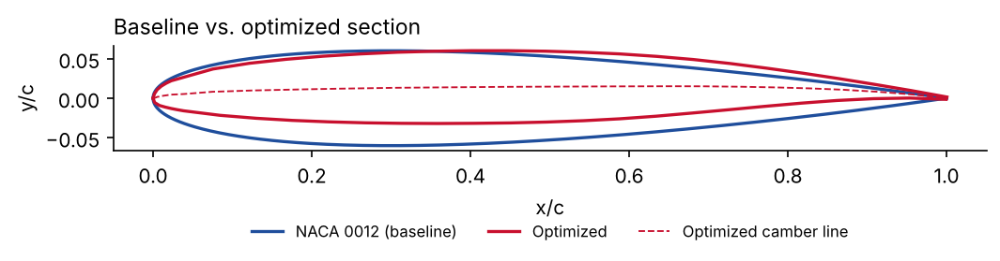
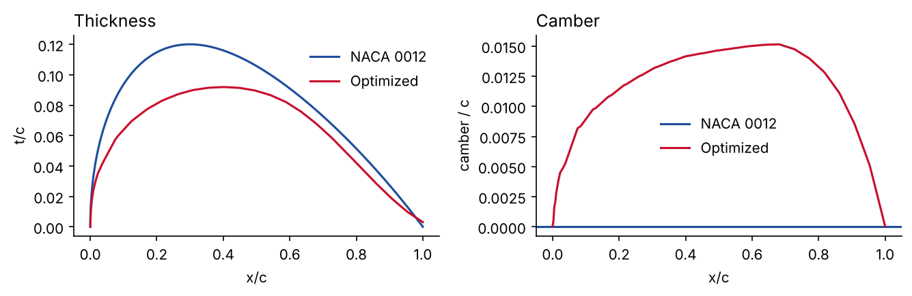
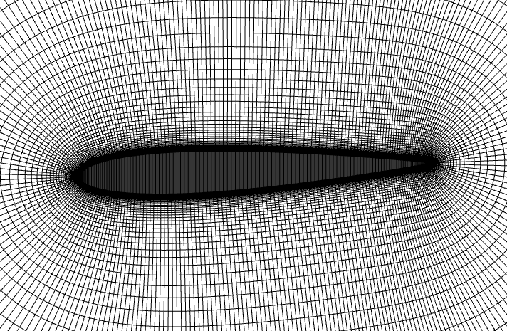
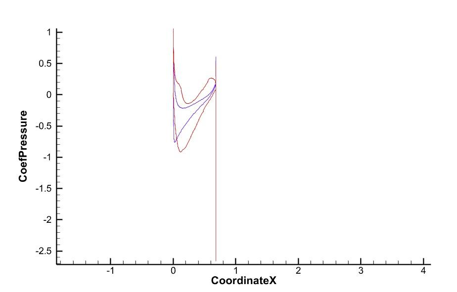

# Adjoint-Based Aerodynamic Optimization of the NACA 0012 Airfoil (MACH-Aero)

Lift-constrained drag minimization of the NACA 0012 airfoil using the open-source
[MACH-Aero](https://github.com/mdolab/MACH-Aero) framework from the MDOLab (University of Michigan):
FFD geometry parameterization (pyGeo), mesh warping (IDWarp), RANS + discrete adjoint (ADflow)
and gradient-based optimization (pyOptSparse / SNOPT).

**Tools:** MACH-Aero (run in the MDOLab Docker image) · Python · Tecplot 360




---

## Problem

| | |
|---|---|
| Objective | minimize C<sub>D</sub> |
| Constraint | C<sub>L</sub> = 0.55 (equality) |
| Design variables | vertical displacements of 10 × 2 FFD control points |
| Geometric constraints | LE/TE fixed against shear, thickness ≥ 10 % of baseline, cross-section area bounds |
| Flow | α = 2° (fixed), V∞ = 30 m/s, M ≈ 0.088, Re ≈ 1.4 × 10⁶, RANS with Spalart–Allmaras |
| Mesh | structured O-mesh (pyHyp), first cell for y⁺ ≈ 1 |

## Workflow

```
Python (prefoil)        pyHyp              MACH-Aero in Docker (MPI)                      Tecplot 360
NACA 0012 + FFD box ──► volume mesh ──► pyGeo ─► IDWarp ─► ADflow (RANS + adjoint) ─► slices / surfaces
                                           ▲                          │                    │
                                           └──── SNOPT (pyOptSparse) ◄┘                    ▼
                                                                                 Cp plots, shape export
```

## Results

| Metric | Baseline NACA 0012 | Optimized |
|---|---|---|
| C<sub>L</sub> | — | **0.55** (constraint met) |
| C<sub>D</sub> | ≈ 0.0121 (estimate) | **0.0101** |
| L/D | ≈ 45 | ≈ 54 |

Geometry of the optimized section, measured from the exported coordinates
(`results/opt2_raw.txt` → `scripts/04_postprocess.py` → `results/geometry_summary.json`):

| | NACA 0012 | Optimized |
|---|---|---|
| Max thickness | 12.0 % c at 30 % c | **9.2 % c at 40 % c** |
| Max camber | 0 | **1.5 % c at 68 % c** (aft-loaded) |
| Cross-section area | 0.082 c² | 0.064 c² (78 %) |

The optimizer added aft camber to generate the required lift at a fixed 2° incidence,
moved the maximum thickness aft, and thinned the section until the **area constraint became active**
(0.0648 c² lower bound). Part of the drag reduction therefore comes from the thinner section,
which a tighter thickness or area constraint would limit.



Mesh and C<sub>p</sub> plots were made in Tecplot 360 from the ADflow output:

| Volume mesh | C<sub>p</sub> comparison (blue: baseline, red: optimized) |
|---|---|
|  |  |

---

## ⚠️ About the scripts

The original run scripts were lost after the study was completed. The scripts in `scripts/` are a
**reconstruction**, written to match the setup documented in the report and the recovered result:

- flow conditions, lift target, fixed α, FFD layout and solver chain come from the report;
- chord (0.686 m) and the incidence of the exported section (1.92°) were recovered from `opt2_raw.txt`;
- the constraint values follow the MACH-Aero airfoil tutorial. The recovered section sits on that
  tutorial's area lower bound, which suggests the same constraints were used.

They follow the standard MACH-Aero workflow, but they have not been re-run end-to-end, so a new run
may not reproduce the reported numbers exactly. Only `04_postprocess.py` runs without MACH-Aero, and it was tested on the exported result.

## Repository layout

```
├── scripts/
│   ├── config.py            # all case settings in one place
│   ├── 01_geometry_ffd.py   # NACA 0012 → blunt TE → resample (prefoil) + fitted FFD box
│   ├── 02_mesh.py           # hyperbolic O-mesh (pyHyp), y+ ≈ 1
│   ├── 03_airfoil_opt.py    # ADflow + IDWarp + pyGeo + pyOptSparse optimization
│   ├── 04_postprocess.py    # normalize result, thickness/camber, Cp from ADflow slices (no Tecplot needed)
│   └── run_all.sh
├── tecplot/plot_results.py  # PyTecplot: Cp + shape plots, coordinate export
├── docker/run_docker.sh     # start the MACH-Aero container with the repo mounted
├── results/
│   ├── opt2_raw.txt               # exported optimized section (original data)
│   ├── optimized_airfoil.dat      # normalized, Selig format (c = 1)
│   ├── geometry_summary.json
│   └── figures/
├── docs/figures/            # figures from the report
└── report/Airfoil_Optimization_Report.pdf
```

## Running

### 1. Start MACH-Aero in Docker
```bash
bash docker/run_docker.sh            # pulls mdolab/public and mounts this repo
```
On Windows (PowerShell, from the repo root):
```powershell
docker run -it --rm -v "${PWD}:/home/mdolabuser/mount/project" mdolab/public:<tag> bash
```
Tags are listed at [hub.docker.com/r/mdolab/public](https://hub.docker.com/r/mdolab/public).

### 2. Run the pipeline inside the container
```bash
cd ~/mount/project/scripts
bash run_all.sh 4 SNOPT      # geometry → mesh → optimization on 4 MPI ranks → plots
```
SNOPT is licensed separately and is not part of the public image. Without it, use the open-source
optimizer: `bash run_all.sh 4 SLSQP`.

ADflow writes Tecplot files to `scripts/output/`: `*_surf.plt` (surface solution) and
`*_slices.dat` (mid-span section with `CoordinateX/Y/Z` and `CoefPressure`).

### 3. Post-process
**Tecplot 360** (PyTecplot): Cp comparison, shape overlay, and export of the optimized section coordinates:
```bash
python tecplot/plot_results.py --dir scripts/output
```
**Without Tecplot** (numpy + matplotlib only), the same plots plus thickness/camber analysis:
```bash
python scripts/04_postprocess.py --slices scripts/output --hst scripts/output/opt.hst
```
`results/opt2_raw.txt` is the optimized section exported from Tecplot. It is stored in the flow
frame: rotated by α and with the leading edge at +x. `04_postprocess.py` normalizes it.

## References

- MDOLab, *MACH-Aero*, https://github.com/mdolab/MACH-Aero
- Kenway, G. K. W., Mader, C. A., He, P., Martins, J. R. R. A. (2019). Effective adjoint approaches for computational fluid dynamics. *Progress in Aerospace Sciences*, 110.
- Spalart, P. R., Allmaras, S. R. (1992). A one-equation turbulence model for aerodynamic flows. AIAA 92-0439.
- Gill, P. E., Murray, W., Saunders, M. A. (2002). SNOPT: an SQP algorithm for large-scale constrained optimization. *SIAM J. Optim.* 12(4).

## Author

**Basil Mehmood** · 2025

Licensed under the MIT License (scripts). The report is © the author.
